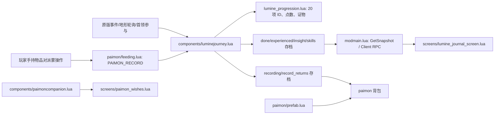

# 旅行手册重构：现状审查（2026-11-13）

本报告根据 `mod/lumine` 的实际调用链整理；0.37.2 是分类与交付原型，不是完整百科。0.38.0 已开始按报告改造，以下风险中首项返还路径和拒绝反馈已修改，仍需游戏内验收。

## 现有结构

## 可复用部分

- `luminejourney` 的旧 `done`、见闻点、技能消费、地形与首领参与判定；旧档含 `done/insight/skills`。
- 派蒙的网络所有者 `_owner`、六格容器、饱食度、对话与已有动作；玩家仅能操作自己的派蒙。
- 手册物品入口、客户端 RPC、页面容器及已编译图标；装备见闻的实战判定和合成台路径。
- 原版物品图标与模组现有装备、元素、神像、圣遗物、兰纳罗素材。

## 必须重构/新建

- 当前 `lumine_progression.lua` 同时装旧里程碑与短文案，缺少章节分类、详细正文、关联与派蒙逐章评论。应新建独立章节定义及校验器。
- `lumine_journal_screen.lua` 仍是 5 行一页的列表和简短弹层；需拆成首页、分类目录、章节阅读页、技能页，保持同一 Screen 内切换避免闪烁。
- `luminejourney` 将奖励、物品快照、队列混在角色组件内；需要抽出记录事务模块，明确提交/记录/结算/返还状态。
- 派蒙的“旅途记录”页只显示一段服务端文字，没有队列详情、拒绝原因、进度或取消/领取交互。
- 当前记录动作复用 `lookaround`/`cheer`，尚无专门书写动画或逐章台词。

## 已确认风险

1. 当前可食证物返还玩家背包，与“返还派蒙格子”不符；派蒙自动进食又可能吞掉放入背包的证物。
2. `GetSaveRecord` 后立即移除实体，`recording` 和 `returns` 保存为表；需用断线、洞穴迁移、满格、叠堆及自定义物品做实际回归。
3. 交付失败多数仅返回 `false`，玩家看不到是未亲历、已记录、忙碌还是无效物品。
4. 现有 20 章中部分首领证物的取得路线与 UI 图标未逐项核实；列表图标和实际提交物可能不同。
5. 记录进度在派蒙对话文字中每秒更新，但手册仅同步记录编号，不同步剩余时间；图文内容也只有一句正文。
6. 旧食物心愿的数据与迁移逻辑仍留在 `paimoncompanion` 中；虽停止发新点菜奖励，仍需清理旧 UI/RPC 的无效分支。
7. 现有静态检查仅覆盖 Lua 语法与部署文件；没有完成游戏内单人、联机和旧档验收。

## 内容清单

- 已实现的原版路线：季节、洞穴、航海、月岛、猪王、远古祭坛、隐士之家及十位首领。
- 可纳入百科但不宜全部发见闻点：原版食物/烹饪、农耕、资源和常见生物；模组元素共鸣、风岩技能、元素力、四阶剑冠衣、合成台、圣遗物收藏、派蒙、兰纳罗小屋。
- 内容应分为“百科可读”与“首获见闻奖励”两层，避免通过大量简单物品刷点数。新章节沿用稳定 ID，首获奖励单独定义。

## 实施次序

1. 先修正记录事务与物品返还，加入明确拒绝反馈及存档安全检查。
2. 建数据驱动章节目录与校验器，先完善现有 20 章，再纳入模组已有系统和精选原版条目。
3. 重建手册导航、图文阅读与搜索/筛选；单 Screen 局部更新。
4. 制作缺失的章节插画与派蒙记录动作；已有图标仅用于准确对应的章节。
5. 进行单人、联机、满格、断线、洞穴、旧档和模组兼容验收；按失败项迭代。
